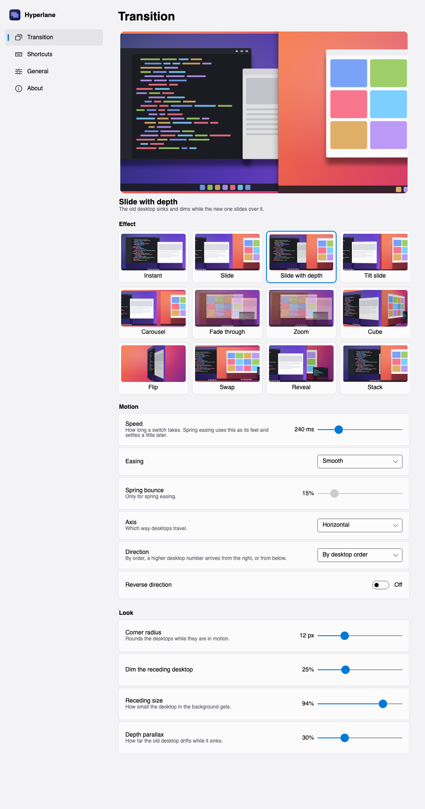

<p align="center">
  
</p>

<h1 align="center">Hyperlane</h1>
<h3 align="center">Animated switching between Windows virtual desktops.</h3>

<p align="center">
  <a href="https://github.com/mberrishdev/Hyperlane/releases/latest"><b>Download</b></a> ·
  <a href="https://github.com/mberrishdev/Hyperlane/issues/new/choose">Report a problem</a> ·
  <a href="CHANGELOG.md">Changelog</a>
</p>

Windows always switches desktops with the same short slide. Hyperlane replaces it with a
transition you choose, or with none at all. It doesn't install a shell extension, patch Explorer
or inject code into other apps.

## Transitions

Twelve effects: **instant**, **slide**, **depth**, **tilt**, **carousel**, **fade**, **zoom**,
**cube**, **flip**, **swap**, **reveal** and **stack**. Settings plays the one you pick, live,
with your speed and easing. Hover over any effect to watch it.

Speed is set in milliseconds. Easing is a curve or a spring with adjustable bounce. Desktops can
travel horizontally or vertically, by their order or always the same way. Corner radius, dimming
and depth are adjustable for the effects that use them.

Pick **Instant** and there's no animation at all: the new desktop is simply there.

## Install

1. Download **`Hyperlane-win-Setup.exe`** from the
   [latest release](https://github.com/mberrishdev/Hyperlane/releases/latest) and run it.
2. That's it. Hyperlane installs for your user (no administrator rights needed), appears in the
   Start menu and in **Settings › Apps › Installed apps**, starts when you sign in, and puts an
   icon in the tray.

Rather not install anything? **`Hyperlane-win-Portable.zip`** runs from any folder and still
updates itself.

The installer isn't code-signed yet, so the first time Windows SmartScreen says it "protected
your PC". Choose **More info › Run anyway**.

**Requirements:** Windows 11 22H2 or newer, x64. On older builds Hyperlane still runs, but falls
back to Windows' own animation, and Settings tells you so.

### Updates

Hyperlane checks for a new version once a day. When there is one, it shows in **Settings ›
About** and at the top of the tray menu, with what's new. Nothing installs until you choose
**Download and restart**, and updates download only what changed. Turn on **Get beta versions**
to try new versions early.

### Uninstall

From **Settings › Apps › Installed apps**, like any other app. Your settings stay in
`%APPDATA%\Hyperlane` in case you come back; delete that folder for a clean slate.

## Use

The tray icon shows the number of the desktop you're on. Click it for Settings; right-click it to
switch desktops, pick an effect or pause animations.

| Keys | Does |
|---|---|
| Ctrl+Win+← / → | Previous / next desktop. Replaces Windows' own slide. |
| Ctrl+Alt+1 … 9 | Go to desktop 1 to 9 |
| Ctrl+Alt+0 | Back to the last desktop you used |
| Mouse buttons 4 / 5 | Previous / next desktop (off by default) |

Every shortcut can be changed in Settings › Shortcuts: click one and press the keys you want.

> [!NOTE]
> On many European keyboard layouts, Ctrl+Alt+digit is the same as AltGr+digit, which types
> characters such as `@` or `€`. If you use those, give the desktop shortcuts other keys.

Hyperlane can also be driven from a terminal or a script while it's running:

```
Hyperlane.exe switch 3 | next | prev | back
Hyperlane.exe effect cube
Hyperlane.exe duration 300
Hyperlane.exe easing spring
Hyperlane.exe pause | resume
Hyperlane.exe status
Hyperlane.exe update [install]
Hyperlane.exe quit
```

## How it works

When you press a shortcut, Hyperlane freezes the current screen in an overlay that screen capture
can't see. It then tells Windows to switch desktops with no animation, picks up the new desktop
from the screen underneath, and plays the transition between the two pictures with Direct3D.
When the transition ends, the overlay disappears and the real windows are already there.

Settings, timings and a log are kept in `%APPDATA%\Hyperlane`.

## Known limitations

- Touchpad four-finger swipes still use Windows' own animation.
- Rotated monitors may animate sideways, and HDR monitors may shift colour slightly while a
  transition plays.
- Switching desktops relies on a private Windows interface. A Windows update can change it, and
  then Hyperlane falls back to Windows' own animation until it is updated.

## Report a problem

[Open an issue](https://github.com/mberrishdev/Hyperlane/issues/new/choose). The bug form asks for
the output of `Hyperlane.exe status` and the log (Settings › General › Open log). Those two
together usually explain what went wrong.

## Credits

Hyperlane is a Windows take on [Spacewalk](https://github.com/InsaneArts/Spacewalk) for macOS by
InsaneArts. Its transitions and approach come from there. The Windows desktop interfaces were
mapped by Markus Scholtes' [VirtualDesktop](https://github.com/MScholtes/VirtualDesktop). The
interface is built with [Avalonia](https://avaloniaui.net). See
[THIRD-PARTY-NOTICES.md](THIRD-PARTY-NOTICES.md) for all licences.

## Licence

Hyperlane is free to download and use, for personal and commercial purposes. It is closed source;
see [LICENSE.md](LICENSE.md).
